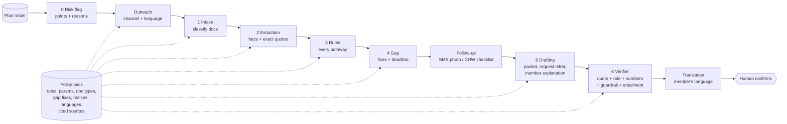

# Coverage Keeper

**Insurers lose members to paperwork, not ineligibility. Our agents don't just remind members — they finish the paperwork.**

Coverage Keeper is an AI member-retention layer for health insurers. It finds members who are about to lose coverage over paperwork, reaches them in their language on the right channel, works out *which* compliance or exemption pathway their documents support, catches the missing evidence, drafts the response packet and the letter to the doctor/school/employer, and tracks the case to done. Every claim it writes is cited to a document line and a rule, and a verifier removes anything unsupported. A human always confirms before anything is sent.

> Built at Hackachusetts 2026 (BU DS+X), Oct 24 2026. **All data is synthetic.** "Maria" is an illustrative composite, not a real person.

## The problem

- In the 2023 Medicaid "unwinding", **72–73% of disenrollments were for procedural (paperwork) reasons** in states reporting reasons ([KFF](https://www.kff.org/medicaid/understanding-medicaid-procedural-disenrollment-rates/): "73% as of September 5, 2023"; "72% of disenrollments are due to procedural reasons" among states reporting as of Oct 11, 2023).
- From **January 1, 2027**, Massachusetts **Medicaid (MassHealth)** adds federal work/community-engagement requirements and six-month renewals for expansion adults (19–64). Massachusetts estimates **about 175,000 people** will lose MassHealth coverage under the new requirements and six-month checks (team brief). Many are exempt or compliant but will lose coverage over paperwork: they don't know they're exempt, send the wrong document, or miss the 30-day deadline.
- For a health plan (e.g. a Medicaid managed-care plan), **every eligible member lost is lost premium/capitation revenue** and broken continuity of care.

Outreach platforms (Ushur, Genesys, Blooming Health, Epiphany) send reminders. **Coverage Keeper finishes the paperwork.**

## What it does (demo: Maria)

Maria, 34, lives in Lawrence, speaks Spanish, and cares for her mother after a stroke. She is likely exempt as a caregiver of a person with a disability but doesn't know it. Her MassHealth letter arrives in English. Without help she would miss the 30-day deadline and lose coverage, and her diabetes prescriptions would stop.

1. **Plan view.** Maria is flagged at-risk (English notice / Spanish speaker, address change, missed notice, not reached in 90 days, possible caregiver exemption).
2. **Outreach.** A text message and a phone script in Spanish, each with the agency's direct contact line and an opt-out.
3. **Documents.** Her caregiver statement (Spanish photo) and her mother's neurology letter.
4. **Rules.** 17 pathways checked; the caregiver-of-a-disabled-individual pathway is supported but **needs evidence**.
5. **Gap caught.** The mother's doctor letter names the stroke but never states a disability or a daily-care need.
6. **Drafting.** A response packet on hold, a request to the mother's doctor quoting the federal definition, and a plain-language explanation in Spanish.
7. **Verifier log.** Every claim checked against an exact quote and a cited rule.
8. **Day 12.** The packet is ready; the plan keeps a member.

## Architecture



- **Each stage is inspectable** in the UI: input/output JSON, engine (LLM or deterministic), model, latency and cost.
- **Models per stage:** Haiku 5.5 (intake), Sonnet 5.5 (extraction, drafting, translation, verifier), Opus 5.5 (clinician-letter interpretation, independent evaluation judge). JSON-schema structured outputs between stages.
- **Deterministic where possible:** thresholds, ages, dates, deadlines and pathway logic are code. The LLM handles interpretation (does this letter say the condition impairs the ability to work?), extraction from messy documents, drafting and translation.
- **Run modes:** `live` calls the API and caches every response on disk. `replay` serves cached responses only (demo-safe, works offline). `offline` uses deterministic engines only. Every LLM stage falls back to its deterministic engine on network failure, so the demo never dies.

### Policy packs (insurer-agnostic)

All program-specific content lives in `packs/<id>/`: scope, pathways and thresholds (as generic evaluator + parameters), exemptions and required evidence, gap codes with fixes and member-facing text, deadlines and process rules, document types and classifier keywords, notice conventions, languages, and the rulebook with source URLs and verbatim quotes. The agents read the active pack; no program specifics live in agent logic or prompts.

| Pack | Line of business | Status |
|---|---|---|
| `masshealth_ce_2027` | Medicaid (MassHealth expansion adults) | 23 rules; 22 quoted verbatim from the CMS interim final rule (42 CFR 435.550–563) and machine-checked against the downloaded text; ambiguous rules marked `needs_confirmation` |
| `employer_dependent_audit_demo` | Employer / commercial plan | **ILLUSTRATIVE, made-up rules**, labelled as such in the UI. Shows the same agents running on a different program (dependent under 26, 60-day window). |

New lines of business (Medicare Advantage, ACA marketplace re-enrollment, non-US private insurers) are new packs, not new code.

## How to run

```bash
pip install -r requirements.txt
python data/generate_cases.py      # 46 synthetic cases with labels
python data/generate_roster.py     # 200-member synthetic plan roster
python data/render_documents.py    # realistic synthetic PDFs + page images (watermarked "SYNTHETIC SAMPLE")
python server.py                   # http://127.0.0.1:8000
```

- **Live LLM mode:** set `ANTHROPIC_API_KEY` (never commit it). Without a key the app runs in `replay` mode: cached responses if present, otherwise deterministic engines.
- **Evaluation (one command):** `python eval/run_eval.py` (deterministic) or `python eval/run_eval.py --llm` (LLM agents + independent judge; cached, so re-runs are free). Results go to `eval/RESULTS.md` and the UI's Evaluation tab.
- **Demo safety:** after one `--llm` run, every response is cached in `cache/`, so `PP_MODE=replay python server.py` replays the demo without network.
- **Check the rulebook quotes:** `python scripts/check_rulebook_quotes.py` confirms every "fetched_verbatim" quote appears in the downloaded Federal Register / SHVS text.

## Evaluation

46 synthetic cases (23 dev / 23 test, alternating so every scenario family appears in both), with hard cases: frailty letters that do or don't state the impact on work, behavioral-health and SUD frailty, stable recovery (excluded), a child aged 13 vs 14, postpartum at the 12-month boundary, 75 hours + less-than-half-time classes, gig income at $571 / $580 / $596, conflicting documents, a 65-year-old and a Medicare member (out of scope), Spanish and Portuguese documents, stale pay stubs, tipped wages, and cases with no qualifying pathway.

Every case document is also rendered as a realistic, watermarked PDF (letterheads, pay-stub forms, handwritten-style statements, ID cards). **Robustness check:** reading text back out of those PDFs with naive extraction drops the deterministic engine from 46/46 to 28/46 (form labels and values split onto separate lines). Layout-aware extraction (`keeper/docs.py: pdf_to_text`) restores 46/46 (`python scripts/smoke_pdf.py`).

Headline numbers on the **held-out test split**. The current table is in [`eval/RESULTS.md`](eval/RESULTS.md).

| Run | n | Top-1 | Top-2 | Sufficiency | Gap P | Gap R | Unsupported claims | Latency | Cost |
|---|---|---|---|---|---|---|---|---|---|
| Deterministic baseline, verifier off | 23 | 100% | 100% | 100% | 100% | 100% | 0/376 (0%) | 3 ms | $0 |
| Deterministic baseline, verifier on | 23 | 100% | 100% | 100% | 100% | 100% | 0/376 (0%) | 3 ms | $0 |
| LLM agents, verifier off / on | 23 | *run `--llm`* | | | | | *headline ablation* | | |

**Read these honestly.** The deterministic engine was written alongside the synthetic document templates, so 100% is an upper bound on template-like documents, not evidence of generalisation. Its drafts are built from grounded facts, so they are supported by construction. The verifier ablation matters for the **LLM drafter**: `--llm` measures unsupported claims in raw LLM drafts vs after the verifier, judged by grounding checks plus an independent Opus entailment judge.

**Risk flagging** (200 synthetic members, 74 labelled would-lose-for-paperwork):

| Method | P@20 | R@20 | P@40 | R@40 | P@60 | R@60 |
|---|---|---|---|---|---|---|
| Coverage Keeper risk points | 80% | 22% | 68% | 36% | 62% | 50% |
| Soonest deadline first | 55% | 15% | 45% | 24% | 50% | 41% |
| Random | 30% | 8% | 20% | 11% | 30% | 24% |

The labels come from a synthetic latent model using the same feature families, and the hand-set points were *not* fit to them. This tests ranking under assumed dynamics, not real-world accuracy.

**Fairness:** results are broken down by member language and case type in `eval/RESULTS.md` and in the UI.

## Responsible AI and guardrails

- **Never decides eligibility.** The tool says "likely pathway" and "documents support". The verifier strips decision language ("is eligible", "is exempt", "approved", "guaranteed"). Packets stay drafts until a coordinator ticks a confirmation box.
- **Citations on every claim.** Each sentence is a typed claim (fact / finding / rule / request) carrying a document quote and/or a rule ID. The verifier checks that the quote is present verbatim, the rule exists, every number appears in the support, there's no decision language, and (live mode) that the LLM entailment check passes. Removals are logged and shown.
- **Ambiguity shown, not guessed.** Medical-frailty letter requirements, postpartum length (placeholder 12 months), "part-time" vs "half-time", accepted caregiving documentation, the 45-day renewal form, and day counting for the 30-day window are all marked `needs_confirmation` in the UI.
- **What leaves the machine.** Synthetic data only. In live mode, document text goes only to the Anthropic API call that processes it. Nothing goes to other third parties, and document contents aren't logged. The cache and navigator-entered cases are local and git-ignored. Offline/replay mode sends nothing.
- **Fairness.** Evaluation is reported by language and case type.
- **No dark patterns.** Outreach always gives the agency's direct contact line and a text opt-out, never asks for an SSN by text, and never implies a decision.
- **Risk flags only help.** The score is a transparent points list with reasons. It only orders who is offered help first, and is never used to deny, delay or deprioritise coverage or services.
- **Human in the loop.** Coordinators and navigators review everything. Machine-drafted translations are labelled for native-speaker review.

## Limitations

- Synthetic data, small n (46 cases; one case is about 4 points). No real documents, OCR noise or adversarial inputs at scale.
- mass.gov pages returned HTTP 403 to automated clients, so MassHealth-specific wording ($580 in MassHealth's own words, "part-time", the 45-day renewal form, the blue envelope) comes from the team brief and is marked `needs_confirmation`. Federal rules are quoted verbatim from 91 FR 33348.
- The deterministic baseline is template-tuned (see above). The LLM run is the generalisation test.
- Offline translations are machine-drafted templates. Live mode uses Claude, but either way a native speaker should review.
- We deliberately leave income verification to CMS's Emmy and vendors. For income/hours cases we only check the documents provided against the thresholds.
- The capitation figure in the plan view ($600 PMPM) is an illustrative assumption, not a sourced number. Case statuses in the plan view are synthetic.

## Sources

- CMS interim final rule, *Medicaid Program; Community Engagement Requirement for Certain Individuals*, 91 FR 33348 (June 3, 2026): https://www.federalregister.gov/documents/2026/06/03/2026-11094/medicaid-program-community-engagement-requirement-for-certain-individuals (full text fetched via the federalregister.gov API)
- SHVS / Manatt, *Medicaid Work Reporting Requirements: Verifying Compliance and Exemptions*: https://shvs.org/resource/medicaid-work-reporting-requirements-verifying-compliance-and-exemptions/
- KFF, *Understanding Medicaid Procedural Disenrollment Rates*: https://www.kff.org/medicaid/understanding-medicaid-procedural-disenrollment-rates/
- MassHealth pages (not fetchable, HTTP 403; listed for reference): new work and education requirements, screener, federal updates, Sept 2026 stakeholder presentation; CMS Medicaid eligibility.

## Repo layout

```
server.py                 FastAPI app + SSE pipeline stream
static/                   UI (plan view, case view, evaluation, packs, responsible AI)
keeper/                   core agents (program-agnostic)
  pipeline.py             orchestrator + trace
  risk.py  plan.py        risk flagging, plan view
  stages/                 outreach, intake, extract, rules, gaps, draft, verify
  llm.py                  Anthropic client, JSON schemas, disk cache, cost
packs/                    policy packs (rules.json with cited quotes + pack.json)
data/                     synthetic case + roster generators
eval/run_eval.py          one-command evaluation -> eval/RESULTS.md
docs/                     demo script, Devpost text, slide outline
```
